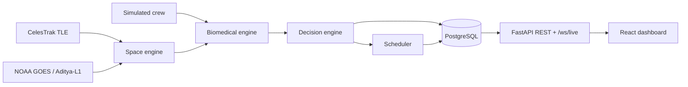

# ASTRA SHIELD AI

Mission-control decision support that warns when an astronaut is at risk from **space radiation and sleep loss at the same time**, and re-plans the crew's 24-hour schedule **around predicted radiation passes**.

**Live:** _deployment in progress, see [docs/DEPLOY.md](docs/DEPLOY.md)_ · **Repo:** https://github.com/khanallyna56-afk/astra-shield-ai

[](https://github.com/khanallyna56-afk/astra-shield-ai/actions/workflows/ci.yml)

## The problem

In low Earth orbit, crews face space radiation and fragmented sleep (about 16 sunrises a day). These are monitored in separate tools, so nobody sees the dangerous moment when a radiation event hits a tired astronaut.

## The solution

One system that fuses real space data with crew health data, scores compound risk per astronaut, and acts:

- **Space engine:** orbit (Skyfield SGP4), day/night (DE421), South Atlantic Anomaly passes, GOES flare class.
- **Biomedical engine:** radiation score (SAA, flare, location shielding) and sleep-deficit score (debt, HRV, fatigue, circadian load).
- **Decision engine:** one risk number 0–100, then alerts, lighting changes, EVA postponement and reassignment.
- **Scheduler:** a greedy 24 h re-planner that keeps EVA and exercise out of predicted SAA windows and protects sleep.
- **Dashboard:** five live pages over REST + WebSocket.

```
Risk = 0.60 × RadiationScore + 0.40 × SleepDeficitScore
Nominal < 40 · Caution 40–69 · Critical ≥ 70
```

## Architecture



Details: [docs/ARCHITECTURE.md](docs/ARCHITECTURE.md) · Design decisions: [docs/DECISIONS.md](docs/DECISIONS.md)

## Run it

**Docker (Postgres, backend, frontend):**
```bash
cp .env.example .env
docker compose up --build
# Dashboard http://localhost:5173 · API docs http://localhost:8000/docs
docker compose -f docker-compose.test.yml up --build --abort-on-container-exit   # tests
```

**Without Docker (Windows, SQLite):**
```powershell
cd backend
py -3 -m venv .venv
.venv\Scripts\python -m pip install -r requirements-dev.txt
"DATABASE_URL=sqlite+aiosqlite:///./astra.db" | Out-File -Encoding utf8 .env
.venv\Scripts\python -m alembic upgrade head
.venv\Scripts\python -m app.seed
.venv\Scripts\python -m uvicorn app.main:app --port 8000
# second terminal
cd frontend
npm ci
npm run dev        # http://localhost:5173 (proxies /api and /ws to :8000)
```

Tests: `pytest -q --cov=app` (backend, 88 tests, ≥ 95 % engine coverage) · `npm run test -- --run` (frontend).

## Data sources

| Data | Source | Offline fallback |
|---|---|---|
| Orbit (ISS 25544, labelled Gaganyaan-class stand-in) | [CelesTrak](https://celestrak.org/NORAD/elements/gp.php?CATNR=25544&FORMAT=tle), cached 6 h | `backend/app/data/fixtures/iss.tle` |
| Solar X-ray flux | [NOAA SWPC GOES XRS](https://services.swpc.noaa.gov/json/goes/primary/xrays-1-day.json), cached 5 min | `fixtures/flares_sample.json` |
| Aditya-L1 SoLEXS | ISRO PRADAN (manual download) | optional |
| Crew biometrics | Deterministic simulator | always simulated |

`DATA_MODE=live|offline` selects live fetching (with cache and fallback) or fixtures only.

**Adding Aditya-L1 data (ISRO PRADAN):**
1. Register and log in at https://pradan1.issdc.gov.in (Aditya-L1 → SoLEXS).
2. Download a Level-1/Level-2 light curve for your date range.
3. Export it to CSV with columns `time,flux` (optional `unit`, e.g. `counts/s`); convert FITS with `astropy.io.fits` if needed.
4. Place the file in `backend/app/data/aditya/`. The newest CSV is used automatically ahead of GOES.

## Demo

Overview → **Arm scenario** → **Execute**. An X2.1 flare is injected as the spacecraft enters the next SAA pass cluster:
Vyomnaut 02 → **76 critical**, Vyomnaut 01 and 03 → caution, EVA postponed and reassigned to Vyomnaut 03, crew sheltered, warm sleep lighting, schedule re-planned with a diff.
Presenter walkthrough: [docs/DEMO_SCRIPT.md](docs/DEMO_SCRIPT.md).

## Honest limits

- Prototype decision support, **not a medical device**.
- Crew data is **simulated**.
- Formula weights and thresholds are **design choices, not clinically validated**.
- The SAA is a configurable polygon with a Gaussian intensity, not an AP-8/AP-9 flux model. Dose values are illustrative.

## Impact

Decision support for Gaganyaan-class missions built on Indian and open space data. The sleep engine transfers to Earth: night-shift doctors and nurses face the same circadian disruption.

## Team

- **Allyna Khan**: space systems
- **Suheena Sameen**: biomedical systems
- **Kuhu Dhiman**: product and integration

Licensed under MIT.
