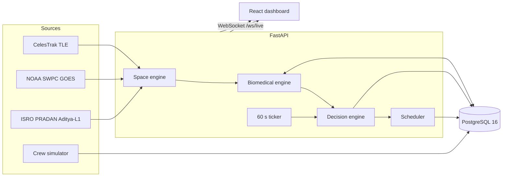

<div align="center">

# ASTRA SHIELD AI

**Compound-risk mission control for crewed spaceflight**

Warns when an astronaut is at risk from **space radiation and sleep loss at the same time**,
then tells the team what to do and re-plans the crew's day **around predicted radiation passes**.

[](https://github.com/khanallyna56-afk/astra-shield-ai/actions/workflows/ci.yml)


**Live demo:** _deploying to Render, see [docs/DEPLOY.md](docs/DEPLOY.md)_

</div>

---

## Contents

- [The problem](#the-problem)
- [What ASTRA SHIELD does](#what-astra-shield-does)
- [The risk model](#the-risk-model)
- [Dashboard tour](#dashboard-tour)
- [The demo scenario](#the-demo-scenario)
- [Architecture](#architecture)
- [Tech stack](#tech-stack)
- [Getting started](#getting-started)
- [Data sources](#data-sources)
- [API reference](#api-reference)
- [Project structure](#project-structure)
- [Testing and CI](#testing-and-ci)
- [Deployment](#deployment)
- [Honest limits](#honest-limits)
- [Impact](#impact)
- [Team](#team)

---

## The problem

In low Earth orbit, a crew sees about **16 sunrises every day**. Sleep fragments, fatigue builds, and heart-rate variability drops. Meanwhile the spacecraft crosses the **South Atlantic Anomaly (SAA)** several times a day, where trapped protons deliver most of the radiation dose, and **solar flares** can raise the hazard further.

Radiation and sleep are tracked in **separate tools**. Nobody sees the dangerous moment when a radiation event hits an astronaut who is already exhausted.

## What ASTRA SHIELD does

| | |
|---|---|
| **Fuses** | Real orbital and solar data with crew health data into **one 0–100 risk score per astronaut** |
| **Predicts** | Every significant SAA pass over the next 24 hours from the spacecraft's actual orbit |
| **Decides** | Postpones or reassigns EVAs, shelters the crew, switches module lighting, raises monitoring |
| **Re-plans** | Rebuilds the 24 h crew schedule so EVA and exercise avoid radiation windows and tired crew get protected sleep |
| **Streams** | Pushes every change to the dashboard over WebSocket within 5 seconds |

**Differentiator:** the schedule is planned **around predicted radiation passes**, not just alerted after the fact.

## The risk model

```
Risk = 0.60 × RadiationScore + 0.40 × SleepDeficitScore        (each 0–100)

Nominal  < 40      Caution  40–69      Critical  ≥ 70
```

**RadiationScore**

```
(10 baseline + 40 × SAA intensity + 40 × flare factor) × location shielding
flare factor:  C = 0.2   M = 0.6   X = 1.0
shielding:     cabin 1.0   sleep station 0.8   shielded area 0.4   EVA 1.6
```

**SleepDeficitScore**

| Component | Weight | Full scale (100) |
|---|---|---|
| Sleep debt (rolling 72 h vs 8 h/night) | 0.40 | 8 h of debt |
| HRV suppression vs personal baseline | 0.25 | 40 % drop |
| Fatigue (Samn-Perelli 1–7) | 0.25 | 7 / 7 |
| Circadian load (orbital sunrises/day) | 0.10 | 16 per day |

All weights are documented design choices (see [docs/DECISIONS.md](docs/DECISIONS.md)), not clinically validated limits.

**Decision rules**

| Trigger | Actions |
|---|---|
| Any crew **critical** + SAA pass active or within 30 min + flare ≥ M | Postpone EVA · Reassign EVA to the safest crew member (nominal, or caution below 55) · Move crew to shielded area |
| Caution or critical crew with sleep deficit > 60 | Module lighting → warm sleep mode (2700 K, dimmed) |
| Caution crew | Advisory alert · Increase monitoring |

## Dashboard tour

A dark operations-console UI with a live telemetry strip (link, data mode, position, altitude, illumination, SAA state, next-pass countdown, X-ray class) on every page.

| Page | Key | What you see |
|---|---|---|
| **Overview** | `1` | Crew panels with animated risk, 0–100 scale, 24 h sparkline and the formula breakdown · orbit map and 24 h environment strip · guided scenario runner · active directives |
| **Orbit & Radiation** | `2` | World ground track with the SAA zone and day/night segments · predicted SAA pass table · GOES X-ray flux on a log scale with flare-class bands |
| **Crew Health** | `3` | Per-astronaut sleep debt, HRV vs baseline, fatigue and simulated cumulative dose (72 h) · radiation vs sleep sub-score trend |
| **Decisions** | `4` | 24 h risk trend with status bands · module lighting state · directives · filterable alert log with acknowledge |
| **Schedule** | `5` | Custom 24 h timeline with SAA bands, dashed outlines where blocks used to be, click-to-inspect, baseline vs re-planned toggle and a change log explaining every move |

Press `?` for shortcuts. A red strip and pop-up notices appear whenever any crew member turns critical. Status is always shown with an icon and a word, never by color alone.

## The demo scenario

**Overview → Arm scenario → Execute.** Fully deterministic and anchored to the predicted orbit, not the wall clock:

1. The mission clock jumps to the start of the next SAA pass cluster.
2. An **X2.1 solar flare** is injected (SAA intensity 0.80).
3. Risk is recomputed:

   | Crew | Radiation | Sleep deficit | Risk | Status |
   |---|---|---|---|---|
   | Vyomnaut 01 | 82 | 30 | 61 | Caution |
   | **Vyomnaut 02** | 82 | 67 | **76** | **Critical** |
   | Vyomnaut 03 | 66 (sleep station) | 22 | 48 | Caution |

4. The decision engine fires: **postpone EVA**, **reassign EVA to Vyomnaut 03**, **move crew to shielded area**, **warm sleep lighting for Vyomnaut 02**.
5. The scheduler moves the EVA to an SAA-free window and extends Vyomnaut 02's sleep to 7 h, with a diff explaining each change.

A backend test asserts these exact outcomes. A 2-minute presenter script is in [docs/DEMO_SCRIPT.md](docs/DEMO_SCRIPT.md).

## Architecture



Engines are pure, unit-tested functions; a thin service layer joins them to the database. More detail in [docs/ARCHITECTURE.md](docs/ARCHITECTURE.md).

## Tech stack

| Layer | Technology |
|---|---|
| Frontend | React 18, Vite, TypeScript, Material UI v6, Tailwind CSS, Plotly, TanStack Query, React Router |
| Backend | FastAPI, Pydantic v2, SQLAlchemy 2 (async), Alembic |
| Science | Skyfield (SGP4, JPL DE421), NumPy, Pandas |
| Database | PostgreSQL 16 (SQLite for local runs without Docker) |
| Live updates | WebSocket `/ws/live`, 5 s polling fallback |
| Ops | Docker Compose, GitHub Actions, Render |

## Getting started

### Option A: Docker (recommended)

```bash
git clone https://github.com/khanallyna56-afk/astra-shield-ai.git
cd astra-shield-ai
cp .env.example .env
docker compose up --build
```

- Dashboard: http://localhost:5173
- API docs (Swagger): http://localhost:8000/docs

### Option B: Without Docker

Requires Python 3.11+ and Node 20+.

**Backend** (uses a local SQLite file):

```bash
cd backend
python -m venv .venv
# Windows: .venv\Scripts\activate    macOS/Linux: source .venv/bin/activate
pip install -r requirements-dev.txt
# create backend/.env containing this single line (UTF-8):
#   DATABASE_URL=sqlite+aiosqlite:///./astra.db
python -m alembic upgrade head
python -m app.seed
python -m uvicorn app.main:app --port 8000
```

**Frontend** (second terminal; proxies `/api` and `/ws` to port 8000):

```bash
cd frontend
npm ci
npm run dev
```

Open http://localhost:5173.

### Configuration

| Variable | Default | Purpose |
|---|---|---|
| `DATA_MODE` | `offline` | `live` fetches CelesTrak / NOAA (cached, with fallback); `offline` uses bundled snapshots |
| `DATABASE_URL` | Postgres in Compose | Any `postgres://`, `postgresql+asyncpg://` or `sqlite+aiosqlite://` URL |
| `CORS_ORIGINS` | `http://localhost:5173,…` | Comma-separated allowed origins |
| `CORS_ORIGIN_REGEX` | – | Regex for hosted frontends |
| `RISK_W_RADIATION` / `RISK_W_SLEEP` | `0.60` / `0.40` | Fusion weights |
| `VITE_API_URL` / `VITE_API_HOST` | – | Frontend build-time API location for split hosting |

> **Windows note:** if Smart App Control blocks native modules, see [docs/DECISIONS.md](docs/DECISIONS.md) (SQLAlchemy 2.0 pure-Python fallback, Rollup WebAssembly build). Both are already configured.

## Data sources

The demo works **with no internet**: every external source has a bundled fallback.

| Data | Source | Cache | Offline fallback |
|---|---|---|---|
| Orbit: ISS (NORAD 25544), a labelled stand-in for a Gaganyaan-class LEO | [CelesTrak](https://celestrak.org/NORAD/elements/gp.php?CATNR=25544&FORMAT=tle) | 6 h | `backend/app/data/fixtures/iss.tle` |
| Solar X-ray flux, GOES XRS 1–8 Å | [NOAA SWPC](https://services.swpc.noaa.gov/json/goes/primary/xrays-1-day.json) | 5 min | `backend/app/data/fixtures/flares_sample.json` |
| Solar X-ray, Aditya-L1 SoLEXS | [ISRO PRADAN](https://pradan1.issdc.gov.in) | – | optional user file |
| Crew biometrics | Deterministic seeded simulator | – | always simulated |

**Using Aditya-L1 data from ISRO PRADAN**

1. Register and log in at https://pradan1.issdc.gov.in, then open **Aditya-L1 → SoLEXS**.
2. Download a light-curve product for your date range.
3. Convert it to CSV with columns `time,flux` (optional `unit`, e.g. `counts/s`). For FITS files, `astropy.io.fits` reads the table.
4. Drop the CSV into `backend/app/data/aditya/`. The newest file is used automatically, ahead of GOES.

## API reference

Interactive docs at `/docs`.

| Method | Endpoint | Description |
|---|---|---|
| GET | `/api/health` | Liveness and database check |
| GET | `/api/mission/overview` | Crew risk, space state, actions, lighting, alerts in one call |
| GET | `/api/space/state` | Position, illumination, SAA, next pass, flare class |
| GET | `/api/space/groundtrack?hours=24` | Ground track (60 s steps), SAA polygon, eclipse windows |
| GET | `/api/space/saa-passes?hours=24` | Predicted significant SAA passes |
| GET | `/api/space/flares` | GOES / Aditya-L1 flux series and current class |
| GET | `/api/crew` | Crew with scores and latest readings |
| GET | `/api/crew/{id}/readings?hours=72` | Biometric history, simulated dose, risk trend |
| GET | `/api/risk/current` | Current risk and formula parameters |
| GET | `/api/risk/history?hours=24` | Risk history per astronaut |
| GET | `/api/schedule?version=baseline\|latest` | 24 h schedule, SAA passes, change diff |
| POST | `/api/schedule/replan` | Re-plan now from current risk |
| GET | `/api/alerts` | Alert log |
| POST | `/api/alerts/{id}/ack` | Acknowledge an alert |
| POST | `/api/demo/solar-flare` | Run the deterministic flare scenario |
| POST | `/api/demo/reset` | Return to normal operations |
| WS | `/ws/live` | Live payload every 5 s plus instant event pushes |

## Project structure

```
astra-shield-ai/
├── backend/
│   ├── app/
│   │   ├── engines/        space · biomedical · decision · scheduler
│   │   ├── data/           TLE + flare clients, crew simulator, cache, fixtures, aditya/
│   │   ├── routers/        mission · space · crew · risk · schedule · alerts · demo · ws
│   │   ├── services.py     joins engines and database
│   │   ├── models.py       SQLAlchemy models (8 tables)
│   │   ├── main.py         FastAPI app, CORS, startup ticker
│   │   └── seed.py         3 astronauts, 72 h readings, baseline schedule
│   ├── alembic/            migrations (0001_init)
│   ├── tests/              88 tests
│   └── Dockerfile
├── frontend/
│   ├── src/
│   │   ├── api/            typed client, live WebSocket provider, hooks
│   │   ├── components/     crew panel, scenario runner, schedule timeline, orbit map/strip, UI kit
│   │   ├── pages/          Overview · Space · Crew · Decisions · Schedule
│   │   └── theme.ts        design tokens and MUI theme
│   ├── Dockerfile          build → nginx
│   └── nginx.conf
├── docs/                   ARCHITECTURE · DECISIONS · DEPLOY · DEMO_SCRIPT
├── .github/workflows/ci.yml
├── docker-compose.yml
├── docker-compose.test.yml
└── render.yaml
```

## Testing and CI

```bash
# Backend: 88 tests (engines, data clients, API, WebSocket, exact demo outcomes)
cd backend && pytest -q --cov=app

# Frontend: component tests, lint, type-check, build
cd frontend && npm run test -- --run && npm run lint && npm run build

# Everything in containers
docker compose -f docker-compose.test.yml up --build --abort-on-container-exit
```

| Engine | Coverage |
|---|---|
| Biomedical | 100 % |
| Decision | 100 % |
| Space | 97 % |
| Scheduler | 95 % |

GitHub Actions runs on every push and pull request to `main`: backend tests against a **PostgreSQL 16** service container with an 80 % engine-coverage gate, frontend lint/test/build, and a full `docker compose build`.

## Deployment

One-click **Render Blueprint** (`render.yaml`): PostgreSQL, the FastAPI backend (Docker) and the React frontend (static site), all on free plans.

Dashboard → **New → Blueprint** → select this repo → **Apply**. Step-by-step guide, verification and alternatives (Vercel, single VM) are in [docs/DEPLOY.md](docs/DEPLOY.md).

> Free services sleep after 15 minutes idle. Open the site 1–2 minutes before a live demo.

## Honest limits

- A **prototype**, **not a medical device**.
- **Crew data is simulated.**
- Formula weights and thresholds are **design choices, not clinically validated**.
- The SAA is a configurable polygon with a Gaussian intensity, not an AP-8/AP-9 trapped-particle model; dose values are illustrative.
- The ISS orbit stands in for a Gaganyaan-class orbit because no public Gaganyaan TLE exists.

## Impact

- **Gaganyaan-class missions:** decision support built on Indian (Aditya-L1) and open space data.
- **On Earth:** the sleep engine transfers directly to **night-shift doctors and nurses**, who face the same circadian disruption and fatigue risk.

## Team

| Name | Focus |
|---|---|
| **Allyna Khan** | Space systems |
| **Suheena Sameen** | Biomedical systems |
| **Kuhu Dhiman** | Product and integration |

---

<div align="center">

Released under the [MIT License](LICENSE).

</div>
