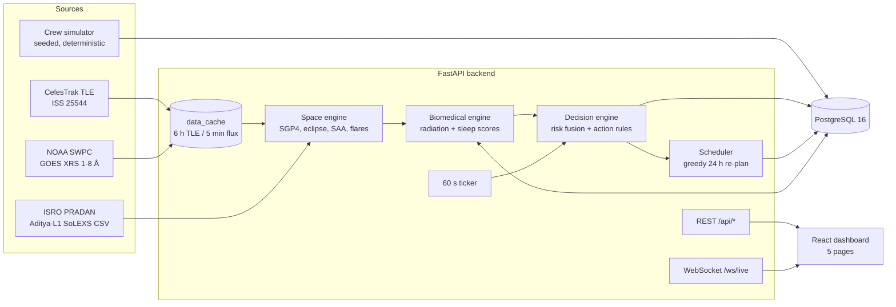

# Architecture

## System view



## Engines

| Engine | File | Inputs | Output |
|---|---|---|---|
| Space | `backend/app/engines/space.py` | TLE, DE421 ephemeris, GOES flux | position, sunlit, SAA state + intensity, predicted SAA passes, sunrise count, flare class |
| Biomedical | `backend/app/engines/biomedical.py` | SAA intensity, flare factor, location, sleep debt, HRV, fatigue, sunrises | RadiationScore 0–100, SleepDeficitScore 0–100 (with components) |
| Decision | `backend/app/engines/decision.py` | per-crew scores, SAA timing, flare class, EVA holder | risk 0–100, status, structured `Action` list |
| Scheduler | `backend/app/engines/scheduler.py` | baseline blocks, SAA passes, hazards, crew risk, sleep debt | new schedule + diff with reasons |

All engines are pure functions or small classes with no I/O; `services.py` joins them to the database and the routers stay thin.

## Risk formula

```
Risk = round(0.60 × RadiationScore + 0.40 × SleepDeficitScore)
GREEN < 40 ≤ AMBER < 70 ≤ RED

RadiationScore = clamp((10 + 40·SAA_intensity + 40·flare_factor) × shielding[location], 0, 100)
    flare_factor: C 0.2, M 0.6, X 1.0     shielding: cabin 1.0, sleep station 0.8, shielded 0.4, EVA 1.6

SleepDeficitScore = 0.40·debt + 0.25·HRV_suppression + 0.25·fatigue + 0.10·circadian   (each 0–100)
```

Weights are design choices, not clinically validated.

## Data flow at runtime

1. On startup the backend backfills 24 h of risk history from the real ground track.
2. A 60 s ticker evaluates the engines, stores a `space_snapshots` row, `risk_scores` rows, and de-duplicated `alerts`, then broadcasts on `/ws/live`.
3. Each `/ws/live` client also receives a fresh payload every 5 s. If the socket drops, the UI polls `/api/mission/overview` every 5 s.
4. `POST /api/demo/solar-flare` freezes the mission clock at the next SAA-cluster entry, injects an X2.1 flare, re-runs everything and pushes the result immediately.

## Database

Eight tables (Alembic `0001_init`): `astronauts`, `crew_readings`, `space_snapshots`, `risk_scores`, `schedule_blocks` (versioned: 0 = baseline), `alerts`, `data_cache` (JSONB), `scenarios` (JSONB).
Local non-Docker runs use SQLite through the same models.

## Frontend

React 18 + Vite + TypeScript, MUI v6 + Tailwind (preflight off), Plotly for the map and time series, custom SVG/HTML for the risk scale, sparklines, orbit strip and schedule timeline. TanStack Query caches REST calls; the WebSocket writes straight into the `['live']` query.
